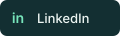
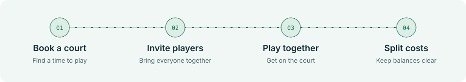
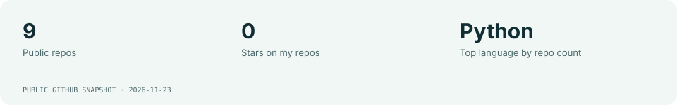

<picture>
  <source media="(prefers-reduced-motion: reduce) and (prefers-color-scheme: dark) and (max-width: 600px)" srcset="assets/hero-dark-mobile-still.svg" />
  <source media="(prefers-reduced-motion: reduce) and (max-width: 600px)" srcset="assets/hero-light-mobile-still.svg" />
  <source media="(prefers-reduced-motion: reduce) and (prefers-color-scheme: dark)" srcset="assets/hero-dark-still.svg" />
  <source media="(prefers-reduced-motion: reduce)" srcset="assets/hero-light-still.svg" />
  <source media="(prefers-color-scheme: dark) and (max-width: 600px)" srcset="assets/hero-dark-mobile.svg" />
  <source media="(max-width: 600px)" srcset="assets/hero-light-mobile.svg" />
  <source media="(prefers-color-scheme: dark)" srcset="assets/hero-dark.svg" />
  
</picture>

  
  
  

## Currently building

**[Badminton Bookings ↗](https://badminton.divy.cc)** — a home for community badminton. Organize sessions, invite players, find courts, and keep shared costs simple.

<picture>
  <source media="(prefers-reduced-motion: reduce) and (prefers-color-scheme: dark) and (max-width: 600px)" srcset="assets/badminton-dark-mobile-still.svg" />
  <source media="(prefers-reduced-motion: reduce) and (max-width: 600px)" srcset="assets/badminton-light-mobile-still.svg" />
  <source media="(prefers-reduced-motion: reduce) and (prefers-color-scheme: dark)" srcset="assets/badminton-dark-still.svg" />
  <source media="(prefers-reduced-motion: reduce)" srcset="assets/badminton-light-still.svg" />
  <source media="(prefers-color-scheme: dark) and (max-width: 600px)" srcset="assets/badminton-dark-mobile.svg" />
  <source media="(max-width: 600px)" srcset="assets/badminton-light-mobile.svg" />
  <source media="(prefers-color-scheme: dark)" srcset="assets/badminton-dark.svg" />
  
</picture>

Built with **Next.js, TypeScript, Prisma, and PostgreSQL**.

## Tech I work with

<picture>
  <source media="(prefers-reduced-motion: reduce) and (prefers-color-scheme: dark) and (max-width: 600px)" srcset="assets/stack-dark-mobile-still.svg" />
  <source media="(prefers-reduced-motion: reduce) and (max-width: 600px)" srcset="assets/stack-light-mobile-still.svg" />
  <source media="(prefers-reduced-motion: reduce) and (prefers-color-scheme: dark)" srcset="assets/stack-dark-still.svg" />
  <source media="(prefers-reduced-motion: reduce)" srcset="assets/stack-light-still.svg" />
  <source media="(prefers-color-scheme: dark) and (max-width: 600px)" srcset="assets/stack-dark-mobile.svg" />
  <source media="(max-width: 600px)" srcset="assets/stack-light-mobile.svg" />
  <source media="(prefers-color-scheme: dark)" srcset="assets/stack-dark.svg" />
  
</picture>

A little GitHub activity

<picture>
  <source media="(prefers-color-scheme: dark) and (max-width: 600px)" srcset="assets/stats-dark-mobile.svg" />
  <source media="(max-width: 600px)" srcset="assets/stats-light-mobile.svg" />
  <source media="(prefers-color-scheme: dark)" srcset="assets/stats-dark.svg" />
  
</picture>

## One contribution at a time

<picture>
  <source media="(prefers-reduced-motion: reduce) and (prefers-color-scheme: dark)" srcset="assets/contributions-dark-still.svg" />
  <source media="(prefers-reduced-motion: reduce)" srcset="assets/contributions-light-still.svg" />
  <source media="(prefers-color-scheme: dark)" srcset="assets/contributions-dark.svg" />
  
</picture>

Made with SVG, a little motion, and a lot of time at the keyboard. Contribution animation by <a href="https://github.com/Platane/snk">Platane/snk</a>.
